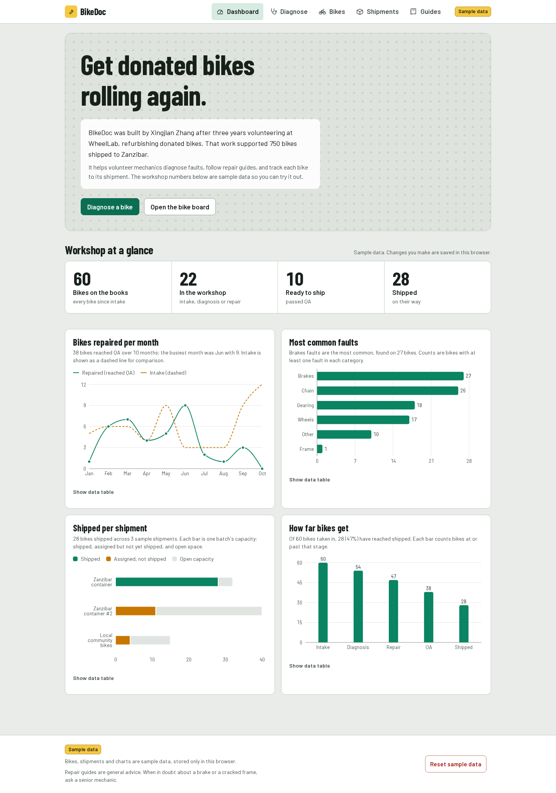
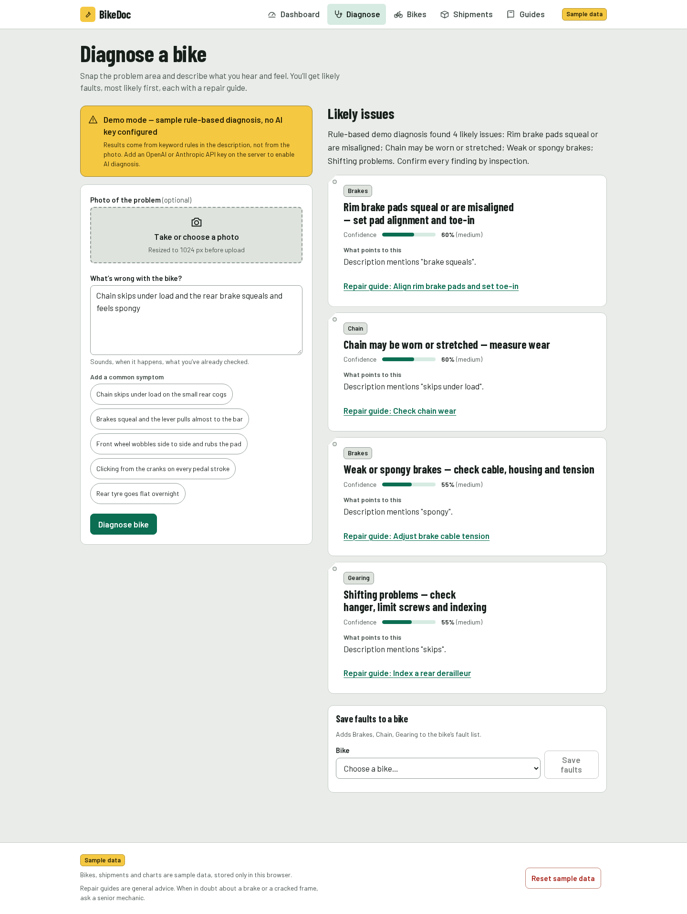
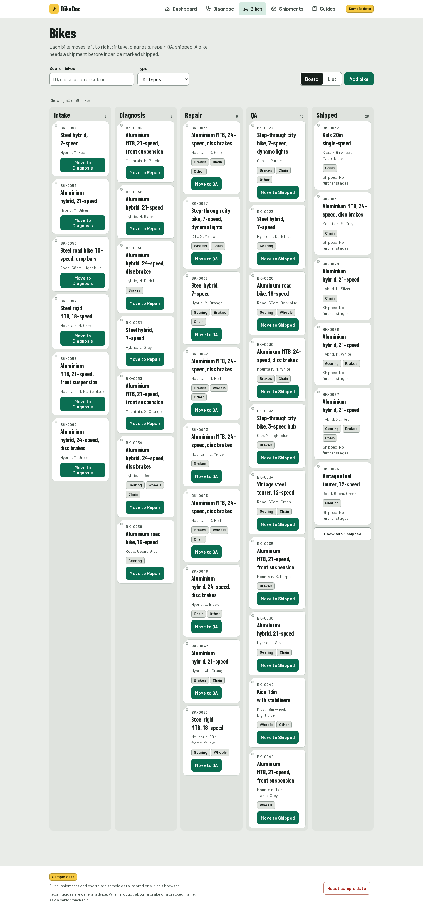
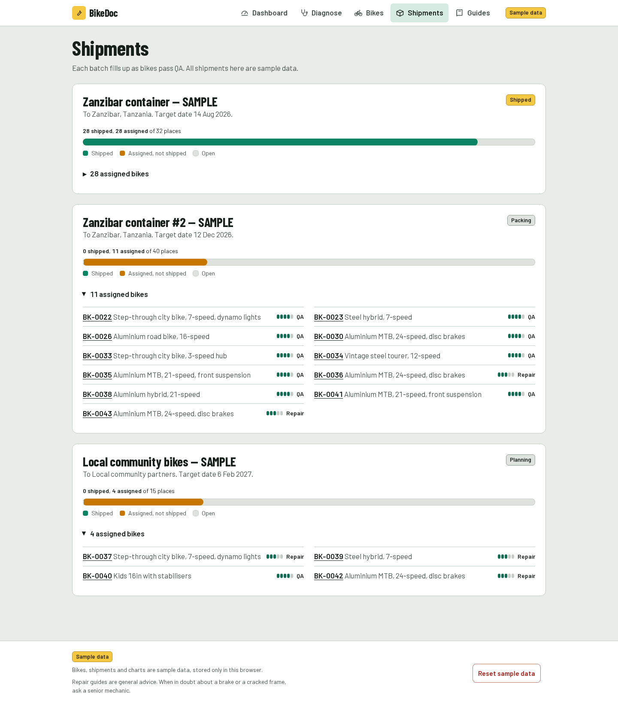
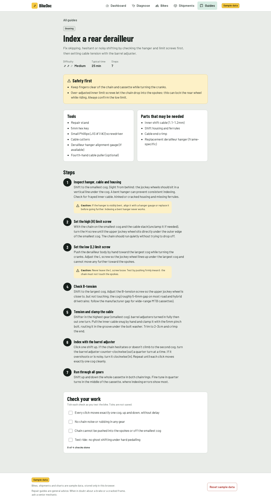
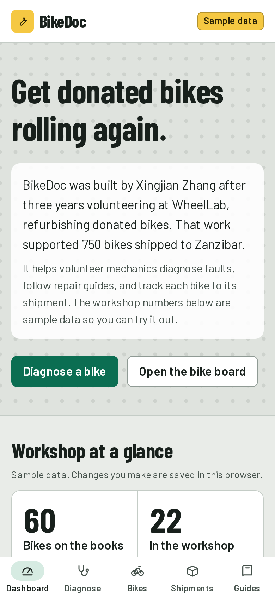
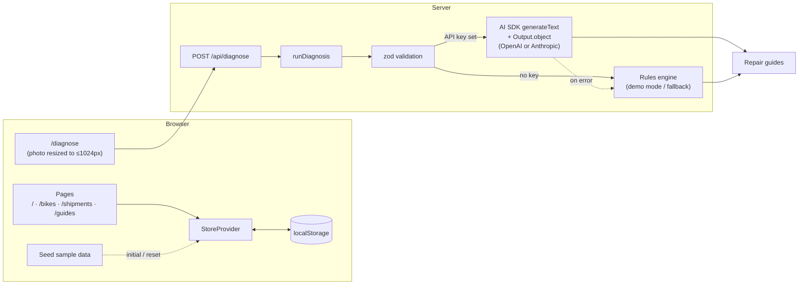

# BikeDoc

An AI bike repair assistant for volunteer mechanics: diagnose faults from a photo and a description, follow step-by-step repair guides, and track every donated bike from intake to shipment.

**Live demo:** LIVE_URL_TBD

## Motivation

BikeDoc was built by Xingjian Zhang, drawing on 3 years of volunteering at WheelLab refurbishing donated bikes, work that supported 750 bikes shipped to Zanzibar. The tool aims to make that kind of workshop easier to run: faster triage for new volunteers, consistent repair steps, and a clear view of where every bike is.

## Features

- **Diagnose** — upload a photo and describe the symptoms; get likely issues ranked by confidence, each linked to a repair guide. Works without any API key in demo mode using a deterministic rule-based engine.
- **13 repair guides** — step-by-step, with tools and difficulty:
  index rear derailleur, chain wear check, chain replacement, brake pad replacement, brake cable tension, rim brake toe-in, disc rotor rub, wheel truing, flat tire repair, hub bearing check, bottom bracket check, headset adjustment, frame crack inspection.
- **Lifecycle tracker** — move each bike through Intake → Diagnosis → Repair → QA → Shipped, with a full history of events and notes.
- **Shipments** — group finished bikes into shipment batches and track capacity and progress.
- **Impact dashboard** — bikes repaired over time, faults by category, stage funnel, and shipment progress.
- **Sample data** — the app starts with seeded sample bikes and shipments; your changes are saved to `localStorage` and can be reset to the sample data at any time.

## Screenshots

| Dashboard | Diagnose (demo mode) |
| --- | --- |
|  |  |

| Bikes | Shipments |
| --- | --- |
|  |  |

| Repair guide | Mobile |
| --- | --- |
|  |  |

## Architecture



Diagnoses from either path are validated against the same zod schema and link each issue to one of the repair guides.

## Tech stack

- [Next.js](https://nextjs.org) 16 (App Router) with React 19 and TypeScript (strict)
- Tailwind CSS v4
- [AI SDK](https://ai-sdk.dev) v7 with the OpenAI and Anthropic providers
- zod v4 for request and response validation
- Recharts for dashboard charts
- Vitest + Testing Library for tests, ESLint for linting, Playwright for screenshots

## Getting started

Requires Node.js 22.

```bash
npm ci
npm run dev
```

Open http://localhost:3000. No configuration is needed; without an API key the app runs in demo mode.

## AI key setup and demo mode

Copy `.env.example` to `.env.local` and set one key:

| Variable | Purpose |
| --- | --- |
| `OPENAI_API_KEY` | Use OpenAI (default model `gpt-4o-mini`). Preferred if both keys are set. |
| `ANTHROPIC_API_KEY` | Use Anthropic (default model `claude-sonnet-5-5`). |
| `BIKEDOC_MODEL` | Optional model id override for the active provider. |

With no key configured, `/diagnose` shows the banner **"Demo mode — sample rule-based diagnosis, no AI key configured"** and uses the rule-based engine. If an AI call fails, the server falls back to the rules engine and returns a notice instead of an error. Photos are resized client-side to at most 1024px before upload.

## Project structure

```
app/                  Pages (dashboard, diagnose, bikes, shipments, guides) and API routes
  api/diagnose/       POST diagnosis endpoint; GET reports ai/demo mode
components/           UI components
lib/
  ai/                 Provider selection and server-side runDiagnosis
  diagnosis/          zod schemas and the rule-based engine
  guides/             The 13 repair guides
  data/               Deterministic seed (sample) data
  store/              Lifecycle rules, pure state functions, StoreProvider + localStorage
  stats.ts            Dashboard aggregations
  types.ts            Shared domain types
scripts/screenshots.mjs  Playwright screenshot capture
docs/screenshots/     README images
```

## Testing and quality

```bash
npm run lint        # ESLint
npm run typecheck   # tsc --noEmit
npm test            # Vitest
npm run build       # Production build
```

CI runs all four on every push and pull request (in demo mode, no secrets required).

To regenerate the screenshots, start a production server and run the capture script:

```bash
npx playwright install chromium   # first time only
npm run build && npm run start
npm run screenshots               # in another terminal; BASE_URL defaults to http://localhost:3000
```

## Disclaimer

All bikes, shipments, and statistics shown in the app are sample data. Repair guides and diagnoses are guidance only and are not a substitute for a safety check by a qualified mechanic before a bike is ridden.

## License

[MIT](LICENSE) © 2026 Xingjian Zhang
